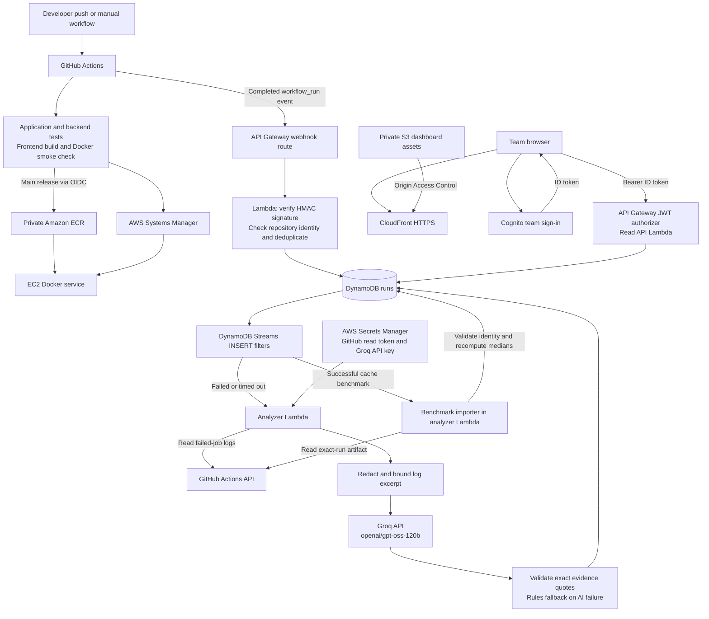

# DeployIQ

AI-assisted monitoring, failure diagnosis, and measured dependency-cache experiments
for a GitHub Actions pipeline. AWS hosts the application, event processing,
authentication, storage, and dashboard; Groq supplies AI inference.

[Open the dashboard](https://d27iom2n4u9pw.cloudfront.net/) ·
[Faculty presentation guide](presentation/README.md) ·
[Faculty demo script](docs/DEMO.md) · [Cache experiment method](evaluation/README.md)

The dashboard requires an invited Cognito team login. Its public URL does not
provide public access to pipeline data.

## What the project does 

- Tests a FastAPI service, builds and smoke-tests its Docker image, then publishes
  an immutable release to private Amazon ECR.
- Deploys main-branch releases to EC2 through AWS Systems Manager using GitHub
  OIDC. A candidate health check precedes the container swap; a failed replacement
  attempts to restore the previous container and fails the deployment job.
- Verifies signed GitHub workflow-run webhooks and stores completed attempts once
  in DynamoDB, scoped to the configured repository name and numeric ID.
- Analyzes failed-job logs asynchronously. Groq returns a likely cause, exact log
  evidence, a suggested fix, and verification steps. Invalid or unavailable AI
  output produces an explicitly labeled Rules fallback.
- Shows real run history and diagnosis through an authenticated React dashboard.
- Imports successful cache-benchmark artifacts, validates their run identity, and
  recomputes measured comparisons for display.

## Architecture



The webhook, diagnosis, and dashboard paths are separate from the sample service's
EC2 deployment. The two stream branches share one analyzer Lambda. Successful
ordinary runs do not call AI; successful benchmark runs import artifacts only.
Groq receives sanitized excerpts outside AWS. The model never executes commands
or applies a fix.

## Demonstrated results

These observations come from the project's captured GitHub Actions summaries and
hosted dashboard. They are historical results, not a live availability guarantee.

| Evidence | Observed result |
| --- | --- |
| [Diagnosis run 39475900064](https://github.com/Bhanuch2006/deployiq/actions/runs/39475900064) | Dashboard displayed **Groq AI**, the missing `requests` diagnosis, the exact `ModuleNotFoundError` quote, and suggested verification steps. |
| [Cache run 38903048448](https://github.com/Bhanuch2006/deployiq/actions/runs/38903048448) | Baseline median **2.29 s**, warm-cache median **1.82 s**, cold fill **2.42 s**; warm installation **20.73% faster**. |
| [Cache run 38908962867](https://github.com/Bhanuch2006/deployiq/actions/runs/38908962867) | Baseline median **2.90 s**, warm-cache median **2.77 s**, cold fill **3.58 s**; warm installation **4.30% faster**. |

Each experiment uses four baseline installations, one cold-cache fill, and three
warm-cache installations in fresh virtual environments. Percentages use the
unrounded measurements; displayed medians are rounded. These measure **pip
installation time only**, excluding remote GitHub cache restore/save, total build
time, and deployment time. The varying results do not establish a guaranteed
speedup. Keep both reports rather than selecting only the larger improvement.

The intentional failure has been observed with Groq diagnosis. The current
passing-fix rerun should be checked during rehearsal; it is not inferred from a
suggested fix. See the [demo script](docs/DEMO.md) for the acceptance checks.

## Run locally

### Sample service

Python 3.12 is the CI and container target. From the repository root:

```bash
cd sample-app
python3 -m venv .venv
source .venv/bin/activate
python -m pip install -r requirements-dev.txt
python -m pytest -q
uvicorn app:app --reload
```

Open [health](http://127.0.0.1:8000/health),
[API docs](http://127.0.0.1:8000/docs), or `/` for the service and release version.

With Docker instead, from the repository root:

```bash
docker build -t deployiq-sample ./sample-app
docker run --rm -p 127.0.0.1:8000:8000 -e APP_VERSION=demo-001 deployiq-sample
```

### Dashboard

Use Node.js 22 (the CI version). In `frontend/`, copy `.env.example` to
`.env.local` and fill `VITE_API_BASE_URL` and `VITE_COGNITO_CLIENT_ID` from stack
Outputs. These are public configuration values, not secret credentials.

```bash
cd frontend
npm ci
npm run dev
```

Open the local URL printed by Vite and use an invited Cognito user's credentials.
The deployed read API must allow that local origin. A browser reload requires
sign-in again because the prototype keeps tokens in memory.

## Deploy and configure

Use the existing `deployiq-monitoring` stack in **us-east-1**. Committing source
alone does not update Lambda code: regenerate and upload the CloudFormation
template, retain existing parameter values, and supply the Groq secret ARN.

| Guide | Purpose |
| --- | --- |
| [Monitoring setup](infrastructure/MONITORING_SETUP.md) | Signed webhook ingestion and repository restrictions. |
| [Analysis setup](infrastructure/ANALYSIS_SETUP.md) | GitHub Actions read token, Groq secret, analyzer, and recovery. |
| [Dashboard setup](infrastructure/DASHBOARD_SETUP.md) | Cognito users, authenticated read API, and local configuration. |
| [Hosting setup](infrastructure/HOSTING_SETUP.md) | Private S3, CloudFront, and GitHub dashboard publishing variables. |
| [Experiment guide](evaluation/README.md) | Benchmark execution, artifact import, and measurement limits. |

After editing backend or infrastructure source:

```bash
python3 infrastructure/scripts/build_monitoring_template.py
python3 infrastructure/scripts/build_monitoring_template.py --check
```

Store the Groq API key as plaintext in Secrets Manager under
`deployiq/groq-api-key`; only its ARN belongs in `GroqApiKeySecretArn`.
The GitHub log-reader token is a separate secret. Do not put either value in
GitHub variables, frontend configuration, repository files, screenshots, or chat.

Main-branch frontend changes publish through **DeployIQ Dashboard** when its five
hosting variables are configured. Main releases through **DeployIQ CI** use a
separate OIDC role and SSM deployment path. The EC2 instance must be online in
Systems Manager, with its instance role able to pull the release from ECR.

## Validation

From the repository root, with the backend development requirements installed in
an activated Python virtual environment:

```bash
python -m pip install -r backend/requirements-dev.txt
python -m unittest discover -s backend/tests -v
python -m unittest discover -s evaluation/tests -v
python infrastructure/scripts/build_monitoring_template.py --check
```

In `frontend/`, run `npm test` and `npm run build`. Application tests use the
sample service's separate development requirements, as shown above.
Provider tests mock responses; a deployed diagnosis is needed to establish real
provider access. For presentation validation, follow [docs/DEMO.md](docs/DEMO.md).

## Boundaries and limitations

- One configured repository and one shared team workspace; no public signup or
  tenant isolation between unrelated teams.
- Ten AI attempts per UTC day, bounded log excerpts, and cached completed
  diagnoses. Old Rules results do not regenerate merely by refreshing.
- Redaction detects common secret patterns but cannot guarantee removal of every
  credential. Only connect appropriate demo logs.
- Evidence validation confirms that quotes appear in the log; it does not prove
  the proposed cause or fix. A passing rerun is separate evidence. The dashboard
  does not automatically link that rerun to an earlier diagnosis or mark it fixed.
- AWS Bedrock quota access was unavailable for this account; deployed inference
  uses Groq. Historical Bedrock and Rules records retain their original labels.
- Container replacement can briefly interrupt the sample service. Rollback is
  attempted on replacement failure; this is not a high-availability deployment.
- GitHub artifacts have finite retention. Validated benchmark data stored in
  DynamoDB remains until deleted. External secrets and retained hosting resources
  need separate cleanup; budget alerts are not spending caps.

## Repository ownership

| Area | Team responsibility |
| --- | --- |
| `infrastructure/`, `.github/workflows/`, `sample-app/` | Member 1: AWS, containers, and delivery. |
| `backend/analysis/` | Member 2: diagnosis worker and provider integration (`ai-engine/` is reserved). |
| `backend/api/`, `backend/webhooks/` | Member 3: authenticated API, events, and storage. |
| `frontend/` | Member 4: dashboard, sign-in, and results display. |
| `evaluation/` | Shared: experiment method, raw measurements, and interpretation. |
